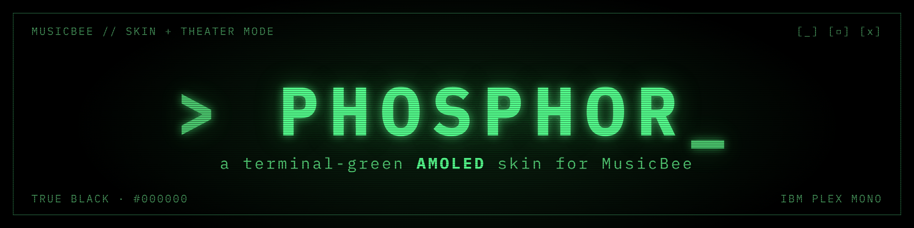
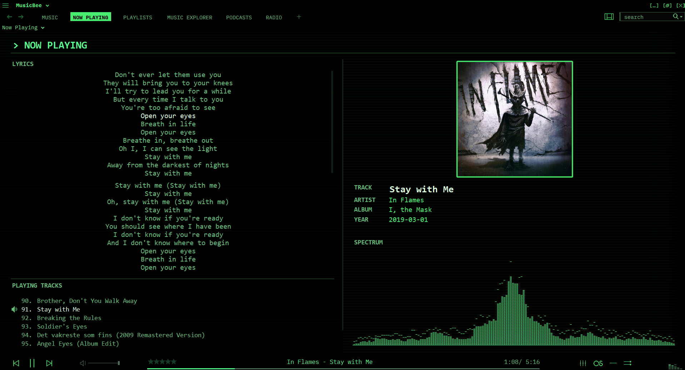
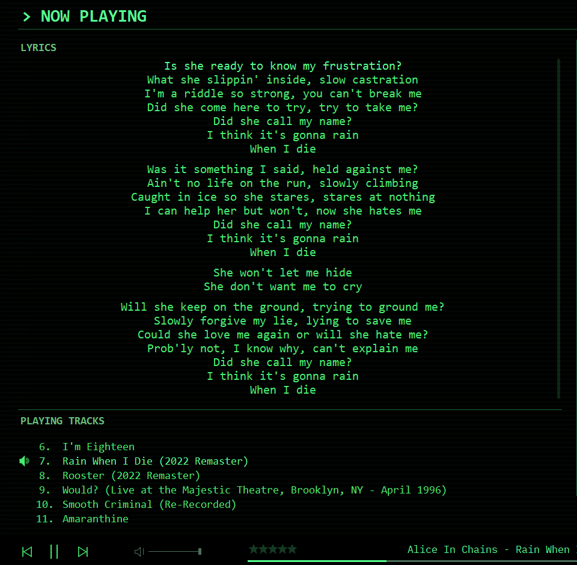
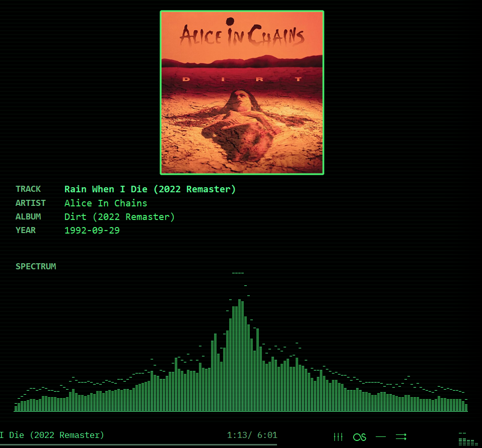
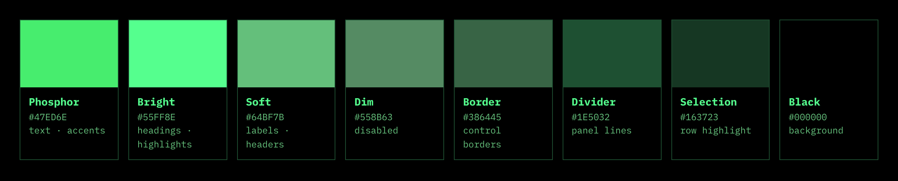

<div align="center">



<br>


**Your music player, as a CRT terminal.**
True-black background, phosphor-green text, scanlines on the Now Playing screen.

</div>

---

## Preview

<p align="center">
  
</p>

<table>
  <tr>
    <td width="50%"></td>
    <td width="50%"></td>
  </tr>
  <tr>
    <td align="center"><sub>Synced lyrics and the playing queue</sub></td>
    <td align="center"><sub>Artwork, track info and live spectrum</sub></td>
  </tr>
</table>

## What you get

| | |
|---|---|
| **Phosphor skin** | A full MusicBee skin in terminal green on pure `#000000`, so pixels switch off on OLED/AMOLED screens. |
| **Terminal Theater Mode** | An embedded Now Playing layout: `> NOW PLAYING` header, lyrics, playing tracks, artwork, track info and a spectrum, drawn over a subtle scanline overlay. |
| **IBM Plex Mono** | The monospace font bundle (SIL OFL) that gives the UI its terminal look. |

## Install

> Close MusicBee before copying files.

**1. Get the files.** Click **Code → Download ZIP** and extract it.

**2. Copy the skin and Theater Mode files** into your MusicBee data folder.

| Installation | MusicBee folder |
|---|---|
| Standard installer | `%APPDATA%\MusicBee` |
| Microsoft Store | `%LOCALAPPDATA%\Packages\50072StevenMayall.MusicBee_kcr266et74avj\LocalCache\Roaming\MusicBee` |
| Portable | The folder containing `MusicBee.exe` |

```text
Skins/Phosphor 1.1.xml → Skins/
Plugins/TheaterMode.Embeded/Phosphor Terminal 1.5.xml → Plugins/TheaterMode.Embeded/
Plugins/TheaterMode.Embeded/Images/Phosphor Terminal Scanlines.png → Plugins/TheaterMode.Embeded/Images/
```

Keep the `Images` subfolder next to the Theater Mode XML so MusicBee can find the scanline texture.

**3. Install the font** (recommended). Open `fonts/IBM-Plex-Mono/`, select all `.ttf` files, right-click → **Install**.

**4. Pick the skin.** Start MusicBee, open **Preferences → Appearance → Skin** and choose **Phosphor**. In the **Now Playing** tab, open **Configure Layout → Main Panel → Theater Mode**, then select **Phosphor Terminal 1.5**. To switch back, select **Phosphor Terminal 1.4**.

**5. Set the font.** In **Preferences → Appearance → Fonts**, choose **IBM Plex Mono** for the best match with the screenshots.

## Changes in Theater Mode 1.5

- The playing track stands out in pale mint in the queue, with a speaker icon marking its row.
- The track title is larger and brighter, with more space before the artist, album, and year.
- The scanlines are softer behind the lyrics and queue. The synchronized lyric colors from 1.4 carry over.
- The screenshots above are from 1.3.

## Palette

<p align="center">
  
</p>

Colours live in the `<variables>` block at the top of `Skins/Phosphor 1.1.xml`. To make a different phosphor (amber, cyan, white), change the green RGB triplets there and in the Theater Mode file.

## Repository layout

```text
musicbee-retro/
├── Skins/
│   └── Phosphor 1.1.xml
├── Plugins/
│   └── TheaterMode.Embeded/
│       ├── Phosphor Terminal 1.5.xml
│       ├── Phosphor Terminal 1.4.xml  (previous version)
│       └── Images/Phosphor Terminal Scanlines.png
├── fonts/
│   └── IBM-Plex-Mono/            (+ OFL.txt)
└── docs/                         (screenshots and banner)
```

## Credits

- Skin based on **FarSe AMOLED / Chameleon Dark v1.6** by *hiccup*, edited by *ENRIVAC*.
- **IBM Plex Mono** © IBM Corp., licensed under the [SIL Open Font License 1.1](fonts/IBM-Plex-Mono/OFL.txt).
- Made for [MusicBee](https://getmusicbee.com/).

<div align="center"><sub><code>&gt; _</code></sub></div>
